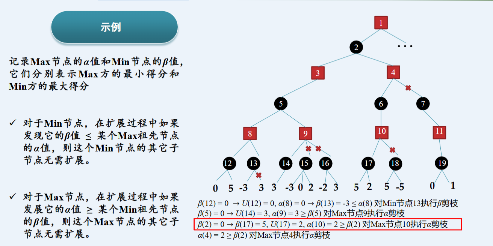

这里是对人工智能课程的一些笔记与总结，可能会包含理论课与实验课的内容。

# 第1讲：绪论

这一讲是一些关于人工智能的历史发展、基本概念的介绍。

## 1.1 人工智能三大学派

**(1) 符号主义**

认为人工智能源于数理逻辑，人类的认知过程本质上是对符号的运算过程（即“物理符号系统假设”），智能可以通过对符号的表示、存储、检索和推理来实现。

主要方法：知识表示、逻辑推理、专家系统。

优点：逻辑严密，可解释性强，推理过程透明，适合处理逻辑性强、规则明确的问题（如数学证明、棋类博弈早期版本）。
缺点：难以处理模糊、不确定的信息；知识获取困难（“知识瓶颈”）；缺乏自学习能力，难以模拟人类的直觉和感知。

**(2) 连接主义**

认为人工智能源于仿生学，特别是对人脑神经元结构和工作机制的模拟，智能产生于大量简单单元（神经元）之间的并行连接和相互作用，强调“学习”的过程，通过调整连接权重来适应环境。

主要方法：神经网络、深度学习、反向传播。

优点：具有强大的自学习能力、容错性和泛化能力；擅长处理图像识别、语音识别、自然语言处理等感知类和非线性问题。
缺点：模型通常是“黑盒”，可解释性差（难以解释为什么得出某个结论）；需要海量数据和巨大的计算资源；训练过程复杂。

**(3) 行为主义**

认为人工智能源于控制论和生物进化论，智能取决于感知和行动，是在与环境的交互中表现出来的（“感知-动作”模式），不需要复杂的内部表示或推理，智能是适应环境的结果。

主要方法：强化学习、遗传算法。

优点：强调实时性和适应性，适合动态环境下的决策和控制；不需要预先定义所有规则，通过与环境试错来优化策略。
缺点：训练周期长，探索成本高；在复杂任务中可能难以收敛到最优解。


# 第2讲：知识表示和推理

人工智能的本质是知识的表示，人工智能是否成功取决于它所蕴含的知识表示是否清楚。

这一讲主要介绍了知识表示和推理的基本概念和方法。

## 2.1 知识表示

- 数据：对客观事物的原始记录或符号描述。它是未经过处理的、孤立的事实、数字、字符、图像像素或声音信号。
- 信息：信息是被处理过、被赋予上下文和数据之间建立联系的数据。
- 知识：知识是经过验证的信息、经验、规则、模式和洞察力的集合，能够用于推理、决策和解决新问题。
- 知识表示：知识表示是将人类知识形式化、结构化，以便计算机能够存储、处理和推理的技术和方法。

AI对知识表示方法的要求：表示能力、可理解性、便于获取、便于搜索、便于推理。

## 2.2 命题逻辑

命题逻辑的基本语法和语义在《离散数学》中已经介绍过，不再赘述，这里解释一下**命题演算形式系统**。

### 2.2.1 命题演算形式系统

命题演算（又称命题逻辑）是数理逻辑的基础系统，研究的是复合命题与其组成部分之间的逻辑关系，而不涉及命题内部的结构；形式系统是一个符号体系，包含以下四个组成部分。
| 要素       | 说明                 |
| -------- | ------------------ |
| **字母表**  | 符号集合（命题变元、联结词、括号等） |
| **形成规则** | 如何构造合法的公式（合式公式）    |
| **公理**   | 系统中被承认为真的基本公式      |
| **推理规则** | 从已知公式推导出新公式的方法     |

### 2.2.2 证明与演绎

需要注意**证明**与**演绎**的区别。
- 证明：从公理出发，通过推理规则得到定理的有限公式序列，记作 $ \vdash \phi_n $
- 推理：从假设/前提集出发，通过推理规则得出结论的过程，记作 $ \Gamma \vdash \phi_n $

### 2.2.3 希尔伯特演绎系统

三个公理：
- 公理1：$A \rightarrow (B \rightarrow A)$
- 公理2：$(A \rightarrow (B \rightarrow C)) \rightarrow ((A \rightarrow B) \rightarrow (A \rightarrow C))$
- 公理3：$(\neg B \rightarrow \neg A) \rightarrow (A \rightarrow B)$

推理规则（分离规则）：$A, A \rightarrow B $ / $ B$

## 2.3 一阶谓词逻辑

一阶逻辑的基本语法和语义在《离散数学》中已经介绍过，不再赘述，这里仅进行一些补充。

### 2.3.1 变量置换

置换是形如 { $ x_1/t_1, x_2/t_2,...,x_n/t_n $ } 的有限集合。

其中 { $ x_1, x_2/...,x_n $ } 是互不相同的变量，{ $ t_1, t_2/...,t_n $ } 是项（常量、变量或函数）。

$ x_i/t_i $ 表示将 $ x_i $ 替换为 $ t_i $，前提是 $ t_i $ 中不含有 $ x_i $，且不能出现循环置换。

> 变量的置换是可以复合的，且具有**结合性**，但不具有交换律。

## 2.4 逻辑推理

**逻辑推理**指的是用蕴涵推导出结论。
**模型验证**则是通过枚举所有可能的模型来验证在当前给定的知识库的前提下，结论都为真。

逻辑推理方法：演绎推理、归纳推理、溯因推理等。
这里主要关注演绎推理，包括自然演绎推理和归结推理。自然演绎推理已经在离散数学课程中学习过，这里主要介绍**归结推理**。

### 2.4.1 归结推理

归结推理是一种自动化的定理证明方法，核心思想是通过归结规则消去互补文字来推导矛盾。

先解释一些概念：
- **文字**：命题变元或命题变元的否定，如 $ P $ 和 $ \neg P $。
- **子句**：任何文字的析取，某个文字本身也是子句，如 $ P \lor Q $ 记作 $ (P, Q) $。
- **子句集**：子句的集合，也是子句的合取，如 $ (P \lor Q) \land (R \lor \neg Q) $ 记作 { $ (P, Q), (R, \neg Q) $ }。
- **归结式**：两个子句 $ (W, R, Q) $ 和 $ (W, S, \neg R) $ 形成的归结式为 $ (W, Q, S) $。

一个定理：两个子句的归结式是这两个子句集的逻辑推论，如 {$(P,A),(\neg P,B)$} $\models (A,B)$。
如果子句集 $S \models NIL$，则 $S$ 的任何一个解释都满足空子句。因为空子句是永假的、不可满足的，所以 $S$ 是不可满足的。

### 2.4.2 命题逻辑的归结推理

推理步骤：
**(1) 转化**：将所有前提和“结论的否定”转化为**合取范式 (CNF)**，得到子句集。
**(2) 归结**：不断对子句集中的子句应用归结规则，生成新子句并加入集合。
**(3) 终止**：若推导出**空子句**（表示矛盾），则证明原命题成立；若无法再生成新子句且未出现空子句，则原命题不成立。


### 2.4.3 谓词逻辑的归结推理

谓词逻辑的归结推理步骤：转化、合一、归结、终止。
可以看到，谓词逻辑的归结推理与命题逻辑类似，但需要考虑**合一**，同时第一步**转化**也会更加复杂一些。

> **合一**：这是谓词逻辑比命题逻辑复杂的地方。命题逻辑里，可以直接消去 $P$ 和 $\neg P$；但在谓词逻辑中，必须先找到一个置换，让两个公式变得一致。例如，要让 $P(x)$ 和 $\neg P(a)$ 矛盾，就需要找到置换 {$x/a$}，让 $P(x)$ 变成 $P(a)$，从而与 $\neg P(a)$ 形成矛盾。寻找这个置换的过程就是合一。

合一项：对于两个语句 $f$ 和 $g$，合一项是指使得这两个语句等价的一个置换 $\sigma$。
**最一般合一项**：最具一般性、限制最少的变量替换。


# 第3讲：搜索算法

## 3.1 基本搜索算法

### 3.1.1 搜索的定义

**状态空间**：表示需要进行搜索的空间，是对问题的形式化。
**动作**：从一个状态到另一个状态，是对实际动作的形式化。
**初始状态**：当前状态的表示。
**目标**：需要达到的目标状态的表示。
**启发式方法**：用于指导搜索的前进方向。
**解**：由“动作”构成的序列。

搜索算法的输入：
**初始状态**：一个具体的物理状态，或者物理状态集合表示的智能体认知状态等。
**后继函数**：S(x) 表示状态 x 经过一个动作后可以达到的状态集合。
**目标测试**：判断当前状态是否为目标状态。
**前进成本**：C(x, a, y) 表示从状态 x 通过动作 a 到达状态 y 的前进成本。

搜索算法的输出：
一个从初始状态到目标状态的“状态-动作”序列。

> 状态 x 的不同后继状态可能来自不同的动作
> S(x) = {<y,a>, <z,b>}
> 这表示状态 y 和 z 都是状态 x 的后继状态，但分别来自不同的动作 a 和 b。

### 3.1.2 搜索算法的性质

**完备性**：如果问题有解，算法一定能找到解。
**最优性**：如果问题有解，算法一定能找到最优解。
**时间复杂度**：最多需要搜索多少个状态。
**空间复杂度**：最多需要存储多少个状态。

### 3.1.3 五种盲目搜索算法

#### 3.1.3.1 广度优先搜索

广度优先搜索（BFS）是一种盲目搜索算法，其基本思想是从初始状态开始，逐层搜索，直到找到目标状态。

BFS 的搜索过程如下：
1. 将初始状态加入队列。
2. 从队列中取出一个状态，检查它是否为目标状态。
3. 如果该状态不是目标状态，则将其所有未访问过的后继状态加入队列。
4. 重复步骤 2 和 3，直到找到目标状态或队列为空。

BFS具有完备性和最优性：
- 短的路径会在任何比它长的路径之前被遍历；
- 给定路径长度，该长度的路径是有限的；
- 最终可以遍历所有长度为 d 的路径，因此一定可以找出最短的解。

b = 问题中一个状态的最大后继状态个数
d = 最短解的动作个数

时间复杂度：$1 + b + b^2 + ... + b^d + b(b^d - 1) = O(b^{d+1})$
空间复杂度：$O(b^{d+1})$

#### 3.1.3.2 深度优先搜索

深度优先搜索（DFS）是一种盲目搜索算法，其基本思想是从初始状态开始，尽可能深地搜索，直到找到目标状态。

DFS 的搜索过程如下：
1. 将初始状态加入栈。
2. 从栈中取出一个状态，检查它是否为目标状态。
3. 如果该状态不是目标状态，则将其所有未访问过的后继状态加入栈。
4. 重复步骤 2 和 3，直到找到目标状态或栈为空。

DFS一般不具有完备性：
- 在状态空间无限的情况下，没有完备性；
- 如果状态空间有限，但存在无限路径（例如存在回路）时，没有完备性；
- 如果状态空间有限，且对重复路径进行剪枝，有完备性。

DFS不具有最优性。

b = 问题中一个状态的最大后继状态个数
m = 遍历过程中最长路径的长度

时间复杂度：$1 + b + b^2 + ... + b^m - b = O(b^m)$
空间复杂度：$ (m-1)(b-1) + b = O(bm)$

#### 3.1.3.3 一致代价搜索

一致代价搜索（UCS）是一种盲目搜索算法，其基本思想是从初始状态开始，按照前进成本从小到大的顺序搜索，直到找到目标状态。

边界中，按照路径的成本升序排列，总是扩展成本最低的那条路径。
若每条路径的成本都相同，则和 BFS 一样。

> 边界：还没有被探索，但下一步准备探索的状态集合。

UCS 的搜索过程如下：
1. 将初始状态加入优先队列。
2. 从优先队列中取出前进成本最小的状态，检查它是否为目标状态。
3. 如果该状态不是目标状态，则将其所有未访问过的后继状态加入优先队列。
4. 重复步骤 2 和 3，直到找到目标状态或优先队列为空。

UCS具有完备性和最优性：
- 假设每个动作的成本非负；
- 一致代价搜索中，所有成本较低的路径都会在成本高的路径之前被扩展；
- 给定成本，该成本的路径数量是有限的；
- 成本小于最优路径的路径数量是有限的；
- 最终，我们可以找到最优的路径。

对于一致代价搜索，若最优解的成本为 $C$，则时间和空间复杂度 $O(b^{C/s+1})$

#### 3.1.3.4 深度受限搜索

宽度优先搜索存在空间复杂度过大的问题。
深度优先搜索存在可能运行时间非常长，甚至在存在无限路径时无限运行下去的问题。

深度受限搜索：
- 是深度优先搜索，但是预先限制了搜索的深度 L；
- 因此无限长度的路径不会导致深度优先搜索无法停止的问题；
- 但只有当解路径的长度 ≤ L 时，才能找到解。

深度受限搜索没有完备性和最优性。

时间复杂度：$O(b^L)$
空间复杂度：$O(bL)$

#### 3.1.3.5 迭代加深搜索

迭代加深搜索（IDS）是一种盲目搜索算法，其基本思想是从初始状态开始，限制搜索的深度，逐步增加搜索深度，直到找到目标状态。

为了解决深度优先搜索和宽度优先搜索存在的问题；
一开始设置深度限制为L = 0，我们迭代地增加深度限制，对于每个深度限制都进行深度受限搜索；
如果找到解，或者深度受限搜索没有节点可以扩展的时候可以停止当前迭代，并提高深度限制L；
如果没有节点可以被剪掉（深度限制不能再提高）仍然没有找到解，那么说明已经搜索所有路径，因此这个搜索不存在解。

IDS 具有完备性；
当每个动作的成本都一致时，具有最优性；
若每个动作的成本不一致，可以用成本边界代替深度限制。

时间复杂度：$(d+1)b^0 + db^1 + (d-1)b^2 + ... + b^d = O(b^d)$
空间复杂度：$O(bd)$


## 3.2 **启发式搜索**

### 3.2.1 **启发式搜索概述**

在盲目搜索中，我们没有考虑边界上的节点哪一个更具有“前景”；
例如在一致代价搜索时，我们总是扩展从初始状态到达当前状态的成本最小的那条路径，却没有考虑过从当前状态点沿着当前路径到达目标路径的成本；
但是，在许多情况下，我们可以**有额外的知识来衡量当前节点**，例如可以知道当前节点到达目标节点的成本。

对于一个具体问题，构造专用于该领域的启发式函数 ℎ(𝑛)，该函数用于估计从节点𝑛到达目标节点的成本；
要求对于所有满足目标条件的节点𝑛，ℎ(𝑛)=0；
在不同的问题领域中，对上述的成本的估计有不同的方法。即，启发式函数是随领域不同而不同的。

> 当前节点到目标的某种距离或者差异的度量；
> 当前节点处于最佳路径的概率；
> 某种条件下的主观if-then规则。

启发式搜索的一个关键在于**设计一个有效的启发式函数**。

但仅仅有启发函数（贪心最好优先搜索）是不够的，因为它只衡量了当前节点到目标节点的成本，而没有衡量从初始状态到当前节点的成本；
相比之下，盲目搜索只考虑了前半部分，能计算出从初始状态到当前节点的成本；
因此，启发式搜索需要结合两者，即**结合启发式函数和前进成本**，来衡量当前节点的“前景”。

评价函数 f(n) = g(n) + h(n)
- g(n) 是从初始状态到当前状态n的成本；
- h(n) 是启发式函数，用于估计从当前状态n到目标节点的成本；

两者相结合看，就是启发式搜索策略，其中的代表是A搜索。

### 3.2.2 **A搜索**

#### 3.2.2.1 评价函数

$f(n) = g(n) + h(n)$

- **$g(n)$**：从初始节点到达节点 $n$ 的实际路径成本（已发生代价），这与一致代价搜索（UCS）中的路径代价一致。
- **$h(n)$**：从节点 $n$ 到达目标节点的成本的启发式估计值（预估剩余代价），这与贪心搜索中的启发函数一致。
- **$f(n)$**：经过节点 $n$ 从初始节点到达目标节点的路径成本的估计值。

搜索过程中，A算法始终扩展边界（frontier）中 $f(n)$ 值最小的节点——即"到目前为止的代价 + 估计的剩余代价"总和最小的节点。

#### 3.2.2.2 算法流程

以下算法流程未启用“环检测”，已经进入closed表的节点可能会再被扩展。

A搜索采用最佳优先搜索框架，使用优先队列（通常为最小堆）来维护边界节点：

1. 将初始节点放入 Open 表，计算 $f(\text{initial}) = g(\text{initial}) + h(\text{initial})$，Closed 表为空。
2. 从 Open 表中取出 $f$ 值最小的节点 $n$。
3. 若 $n$ 为目标节点，搜索成功，返回解路径。
4. 将 $n$ 移入 Closed 表。
5. 扩展 $n$ 的所有后继节点，对每个后继节点 $n'$：
   - 计算 $g(n') = g(n) + c(n, n')$，$f(n') = g(n') + h(n')$。
   - 若 $n'$ 不在 Open 表和 Closed 表中，将其加入 Open 表。
   - 若 $n'$ 已在 Open 表或 Closed 表中但新的 $g$ 值更小，则更新其 $g$ 值和 $f$ 值，并将其重新放回 Open 表。
6. 重复步骤 2\~5，直到 Open 表为空（无解）或找到目标。

#### 3.2.2.3 启发函数的上限问题

直观上理解，启发函数 $h(n)$ 应该低估从节点 $n$ 到目标节点的实际成本，而不能高估。

低估的话，好歹还会去搜一遍，可能搜到更多的路径；而如果高估，则有些被高估的路径可能都不会被搜索到，从而可能错过最优解。从而引出 A* 搜索。

### 3.2.3 **A*搜索**

A* 搜索之所以能保证最优性，关键在于对启发函数 $h(n)$ 的约束条件。

#### 3.2.3.1 可采纳性

对于所有节点 $n$，若满足 $h(n) \leq h^*(n)$，则 $h(n)$ 是**可采纳的**。

可采纳性意味着启发函数**不会高估**从当前节点到达目标的真实最小代价。这使得实际成本最小的最优路径不会被跳过。若 $h(n) > h^*(n)$（高估），搜索算法可能发散，无法保证找到最优解。

特别地，对于任何目标节点 $g$，要求 $h(g) = 0$。

极端情况：$h(n) = 0$ 时，A\*退化为一致代价搜索，始终可找到最优解但效率最低。

#### 3.2.3.2 一致性/单调性

对于任意相邻节点 $n_1$ 和 $n_2$，若满足：

$$h(n_1) \leq c(n_1 \to n_2) + h(n_2)$$

则 $h(n)$ 具有**一致性（单调性）**。其中 $c(n_1 \to n_2)$ 是从 $n_1$ 到 $n_2$ 的步代价。

一致性保证了启发函数的估计不会出现"局部矛盾"。假设这里是大于号，则表明当前有可能是高估的。

满足一致性的启发函数**一定也满足可采纳性**（可通过数学归纳法证明），但反过来不一定成立。

> h(n) 一致时，带环检测的 A* 保证最优。
> h(n) 不一致时，带环检测的 A* 不保证最优。

注意：A* 搜索算法具有指数级的空间复杂度。

### 3.2.4 IDA*搜索

IDA* 搜索（迭代加深的A*搜索）用于解决空间复杂度过大的问题，它类似于迭代加深算法，但是它用于划定界限的不是深度，而是f值，即 g+h 的值。

在每次迭代时，IDA* 划定的界限是f值超过上次迭代的界限最少的节点的f值。

### 3.2.5 松弛问题

通过松弛问题的思路来构建启发式函数。

核心思想非常简洁：把原问题中的一些约束条件放宽（松弛），使问题变简单，然后用这个简单问题中到达目标的成本作为原问题的启发式函数。因为松弛后的问题约束更少、解的空间更大，其最优解成本一定不超过原问题的最优解成本，所以自动满足可采纳性。


## 3.3 对抗（博弈）搜索

### 3.3.1 对抗搜索概述

在之前的学习中，所有搜索问题都基于一个关键假设——智能体对环境拥有完全的控制权。也就是说，除非智能体自己做出改变环境的行为，否则状态不会发生变化，智能体只需构造一条通往目标状态的路径即可。然而，这个假设在现实中并不总是成立：

- 环境可能是随机变化的（如天气、交通状况），这属于**随机环境（Stochastic Environment）**。
- 更重要的是，环境中可能存在与你的利益相冲突的其他智能体。即使你找到了一条通往目标的路径，其他智能体的行为也可能改变状态，使你无法到达目标。

**对抗搜索的定义**

为了处理这种"不是由我们智能体所控制的状态变化"，我们需要将搜索的视角扩展为：

- 存在 **2 个或更多智能体**
- 所有智能体都在行动以**最大化自身利益**
- 智能体之间存在利益冲突，一方的收益往往意味着另一方的损失

**经典搜索与对抗搜索的对比**

| 维度 | 经典/启发式搜索 | 对抗/博弈搜索 |
|------|----------------|--------------|
| 环境 | 单智能主体 | 多智能主体 |
| 优化目标 | 用启发式方法找到最优解 | 因时间受限而被迫执行近似解 |
| 评价方式 | 路径代价估计 | 博弈策略和局势评估 |

### 3.3.2 Minimax搜索

MiniMax是博弈论和人工智能中用于零和、完全信息对抗搜索的经典算法。其核心思想是：双方轮流行动，一方试图最大化收益（MAX），另一方试图最小化收益（MIN），通过递归地向下搜索博弈树来决定最优策略。

#### 基本流程

1. **构建博弈树**：从当前状态出发，枚举所有可能的走法，交替生成MAX节点和MIN节点，直到终局（叶子节点）。
2. **评估叶节点**：使用评估函数对终局状态打分，正值有利于MAX方，负值有利于MIN方。
3. **回溯计算**：
   - 在**MAX节点**，选择子节点中**值最大**的（己方要赢）；
   - 在**MIN节点**，选择子节点中**值最小**的（对手要让你输）。
4. **决策**：根节点（MAX）选择值最大的动作，即为最优走法。

#### 伪代码

```python
def minimax(state, depth, is_maximizing):
    if is_terminal(state) or depth == 0:
        return evaluate(state)
    if is_maximizing:
        value = -∞
        for child in get_children(state):
            value = max(value, minimax(child, depth-1, False))
        return value
    else:
        value = +∞
        for child in get_children(state):
            value = min(value, minimax(child, depth-1, True))
        return value
```

#### 性质与局限

- **完备性**：如果博弈树有限，MiniMax一定能找到解。
- **最优性**：在对手也完美理性时，MiniMax策略是最优的。
- **时间复杂度**：$O(b^m)$，其中 $b$ 为分支因子，$m$ 为最大深度。对于复杂博弈（如国际象棋 $b \approx 35, m \approx 100$），完全搜索不可行。
- **空间复杂度**：$O(bm)$（深度优先搜索只需存储当前路径）。

### 3.3.3 Alpha-Beta剪枝

Alpha-beta剪枝是对MiniMax的关键优化，其核心思想是：**在搜索过程中，如果发现某个分支不可能影响最终决策，就提前剪掉（跳过）该分支**，从而大幅减少搜索量，但结果与MiniMax完全一致。

#### 两个关键值

- **$\alpha$（Alpha）**：MAX方至少能拿到这个值。
- **$\beta$（Beta）**：MIN方至多让MAX拿到这个值。

每一个节点都会维护一个 $\alpha$ 和 $\beta$ 值。祖先的这两个值在深度搜索时会向下传递。

只要出现 $\alpha \geq \beta$，则进行剪枝。



一个更完整的示例见 PPT 第 179~188 页。

真实游戏中根本无法扩展到叶子节点，因此需要启发式地计算非叶子节点的效用值，这样的启发式方法被称为评价函数。

# 第6讲：机器学习

## 6.1 机器学习概述

### 6.1.1 机器学习步骤

设定范围：确定候选的函数集合
设定标准：确定评价函数好坏的标准
达成目标：使用最优化方法找好函数

### 6.1.2 机器学习分类

- 监督学习：已知输入和输出，学习输入到输出的映射关系
- 无监督学习：已知输入，未知输出，学习输入的内在结构
- 半监督学习：已知部分输入和输出，学习输入到输出的映射关系
- 强化学习：已知输入，未知输出，学习在环境中采取行动的长期回报

## 6.2 人工神经网络

### 6.2.1 神经元

神经元是神经网络的基本单元，其结构等同于如下公式。

$$z = \sigma(\sum_{i=1}^{n} w_i x_i + b)$$

### 6.2.2 感知机

与单个神经元不同，感知机的参数是通过训练得到的。

即使激活函数是非线性的，单层感知机（即没有隐藏层的网络）仍然只能处理线性可分任务。

## 6.3 深度学习

### 6.3.1 卷积神经网络

卷积神经网络（Convolutional Neural Network，CNN）是一种专门用于处理图像数据的神经网络。其核心思想是通过卷积操作提取图像特征。


### 6.3.2 循环神经网络

循环神经网络（Recurrent Neural Network，RNN）是一种用于处理序列数据的神经网络。其核心思想是通过循环结构保留序列中的信息。

### 6.3.3 长短期记忆网络

长短期记忆网络（Long Short-Term Memory，LSTM）是一种改进的循环神经网络，它通过引入门控机制来更好地处理长序列中的信息。

## 6.4 决策树

### 6.4.1 CLS算法

### 6.4.2 ID3算法

### 6.4.3 C4.5算法

### 6.4.4 CART算法

## 6.5 无监督学习-聚类

### 6.5.1 K-means算法

### 6.5.2 DBSCAN算法

### 6.5.3 簇评估

## 6.6 强化学习

### 6.6.1 强化学习概述

几个基本要素：智能体、环境、状态、动作、奖励。

- 智能体：执行动作的实体
- 环境：智能体所处的环境
- 状态：智能体所处的环境状态
- 动作：智能体可以执行的动作
- 奖励：智能体执行动作后，环境给予的反馈

马尔可夫决策过程（MDP），其核心是“马尔可夫性质”，即下一个状态只与当前的状态和动作有关，与过去无关。

假设你在玩一个超级玛丽游戏，马尔可夫决策过程由以下五元组定义 **（S, A, P, R, γ）**：

| 要素 | 符号 | 含义 | 游戏中的对应 |
| :--- | :--- | :--- | :--- |
| **状态集合** | **S** | 环境在某一时刻的所有可能情况 | 玛丽当前所在的坐标、脚下的地形、旁边的怪物位置 |
| **动作集合** | **A** | 智能体在某个状态下可以做的所有选择 | 向左走、向右走、跳跃、蹲下 |
| **状态转移概率** | **P** | 执行某个动作后，环境会变成什么新状态（**带概率**） | 按“跳跃”键，有90%概率跳到对面平台，有10%概率脚滑掉下去 |
| **奖励函数** | **R** | 执行动作后，环境立刻给智能体的即时反馈分数，取决于状态和动作 | 吃掉金币得+10分，碰到怪物得-100分（游戏结束） |
| **折扣因子** | **γ** | 对“未来奖励”的重视程度（0~1之间） | 你更看重眼前的金币，还是远处的超级星星？γ越大越目光长远 |

> 现在你看到什么（S），你可以做什么（A），做了以后有多大可能变成什么样（P），能得到多少好处（R），以及你在乎未来多久（γ）。

MDP的核心流程就是 **S → 执行A → 获得R → 进入新的S'**，如此循环往复，直到游戏结束。

> MDP是在定义问题，而强化学习算法（如Q-learning, PPO, DQN等）则是求解问题。

